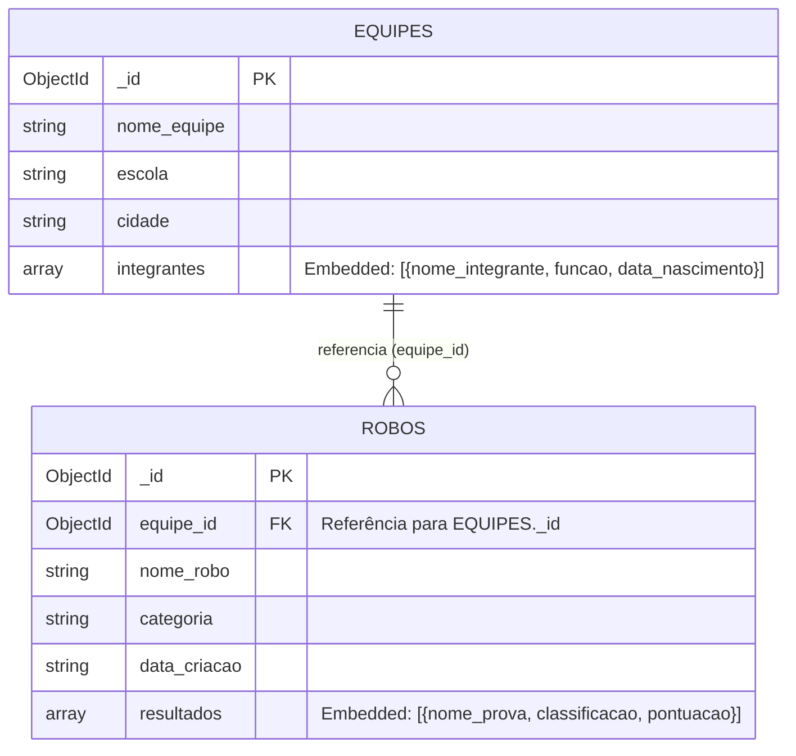

# 🤖 Sistema de Gerenciamento — Torneio de Robótica (IAAD)

Aplicação web interativa desenvolvida em **Python (Dash + Plotly)** integrada a um banco de dados relacional **MySQL**, acompanhada de um módulo comparativo em **NoSQL (MongoDB)** para a disciplina de **Introdução ao Armazenamento e Análise de Dados (IAAD)**.

---

## 👥 Integrantes da Equipe

* Danielle Victória Santana Jordão de Lira
* Ester de Souza Cavalcante
* Ismael Barros Soares
* Paulo Ricardo Ferreira de França
* Pedro Henrique de Oliveira Mota
* Riquelme Ruan Bezerra de Oliveira

---

## 📋 Funcionalidades

* **Módulo Relacional (MySQL + Dash):**
  * **Ranking e Resultados (`dashboard_ranking.py`):** Painel de desempenho geral, indicadores de pontuação e CRUD completo de resultados.
  * **Gestão de Robôs (`dashboard_robos.py`):** Gráficos de distribuição por equipe e CRUD completo de robôs.
  * **Gestão de Equipes (`dashboard_equipes.py`):** Painel administrativo com CRUD completo de equipes e validação de integridade referencial.
  * **Integridade e Regras no Banco (`torneio_robotica_completo.sql`):** Chaves estrangeiras com `ON DELETE CASCADE` e `ON DELETE RESTRICT`, *Trigger* (`trg_validar_pontuacao`) para impedir pontuações negativas e *Stored Procedure* (`sp_desempenho_equipe`).
* **Módulo Não Relacional (Minicurso NoSQL — MongoDB):**
  * Modelagem orientada a documentos comparando **Composição (*Embedded*)** e **Referência (*Reference*)**.
  * Script executável (`nosql/nosql_exemplos.py`) demonstrando operações CRUD e agregações com `$lookup`, `$push` e `$pull`.

---

## 🗂️ Estrutura do Repositório

```text
iaad/
├── assets/                        # Estilos CSS da interface Dash
├── nosql/
│   └── nosql_exemplos.py          # Exemplos executáveis de CRUD e relacionamentos NoSQL
├── componentes.py                 # Componentes visuais reutilizáveis (cards, gráficos, tabelas)
├── conectar.py                    # Teste rápido de conexão e consultas no MySQL
├── crud_equipes.py                # Regras de negócio e CRUD da tabela equipe
├── crud_robos_resultados.py       # Regras de negócio e CRUD das tabelas robo e resultado
├── dashboard_equipes.py           # Interface Dash de Equipes (Porta 8052)
├── dashboard_ranking.py           # Interface Dash de Ranking e Resultados (Porta 8050)
├── dashboard_robos.py             # Interface Dash de Robôs (Porta 8051)
├── gerenciamento_ui.py            # Interface e callbacks compartilhados de gerenciamento
├── torneio_robotica_completo.sql  # Script SQL completo (DDL, DML, Trigger e Procedure)
├── torneiorobotica.mwb            # Modelo Entidade-Relacionamento (MySQL Workbench)
├── requirements.txt               # Dependências Python do projeto
└── README.md                      # Documentação do projeto
```

---

## 📐 Modelagem de Dados (SQL vs. NoSQL)

### 1. Modelo Relacional (MySQL)
Composto por 4 tabelas normalizadas:
* `equipe` (`id_equipe`, `nome_equipe`, `escola`, `cidade`)
* `integrante` (`id_integrante`, `nome_integrante`, `funcao`, `data_nascimento`, `id_equipe`)
* `robo` (`id_robo`, `nome_robo`, `categoria`, `data_criacao`, `id_equipe`)
* `resultado` (`nome_prova`, `classificacao`, `pontuacao`, `id_robo`)

### 2. Modelagem Visual NoSQL (MongoDB)
No paradigma orientado a documentos, as 4 tabelas relacionais são consolidadas em **2 coleções**, demonstrando as duas principais estratégias de modelagem NoSQL:
* **Documentos Embutidos (*Embedded*):** Os `integrantes` ficam aninhados dentro da coleção `equipes`, e os `resultados` ficam aninhados dentro de `robos` (relações `1:N` fortes).
* **Referência (*Reference*):** A coleção `robos` referencia a equipe através do campo `equipe_id`.



---

## 🚀 Instruções de Execução

### 1. Pré-requisitos
* **Python 3.10+**
* **MySQL Server 8.0+**
* **MongoDB Community Server** (opcional, necessário apenas para rodar o módulo NoSQL)

### 2. Instalação das Dependências Python
```bash
git clone [https://github.com/estersouza4/iaad.git](https://github.com/estersouza4/iaad.git)
cd iaad

python -m venv venv
# Windows:
venv\Scripts\activate
# Linux/Mac:
source venv/bin/activate

pip install -r requirements.txt
```

### 3. Configuração do Banco Relacional (MySQL)
1. Abra o **MySQL Workbench** (ou cliente MySQL de preferência) e execute todo o conteúdo do arquivo `torneio_robotica_completo.sql`.
2. Defina a variável de ambiente com a senha do seu MySQL antes de iniciar os painéis:

```bash
# No Windows (PowerShell):
$env:MYSQL_PASSWORD="sua_senha_mysql"

# No Linux/Mac:
export MYSQL_PASSWORD="sua_senha_mysql"
```
*(Opcional: caso seu usuário, host ou porta sejam diferentes do padrão `root`, `127.0.0.1` e `3306`, configure também `MYSQL_USER`, `MYSQL_HOST` e `MYSQL_PORT`.)*

### 4. Executando os Painéis Web (Dash)
Cada módulo possui sua própria aplicação e porta. Abra terminais separados (com o `venv` ativo e a variável `MYSQL_PASSWORD` definida) para executar cada painel:

* **Painel de Ranking e Resultados:**
  ```bash
  python dashboard_ranking.py
  ```
  Acesse: `http://127.0.0.1:8050`

* **Painel de Robôs:**
  ```bash
  python dashboard_robos.py
  ```
  Acesse: `http://127.0.0.1:8051`

* **Painel de Equipes:**
  ```bash
  python dashboard_equipes.py
  ```
  Acesse: `http://127.0.0.1:8052`

### 5. Executando o Módulo NoSQL (MongoDB)
Com o serviço do MongoDB ativo localmente (`mongodb://localhost:27017/`), execute o script de exemplos:

```bash
python nosql/nosql_exemplos.py
```
