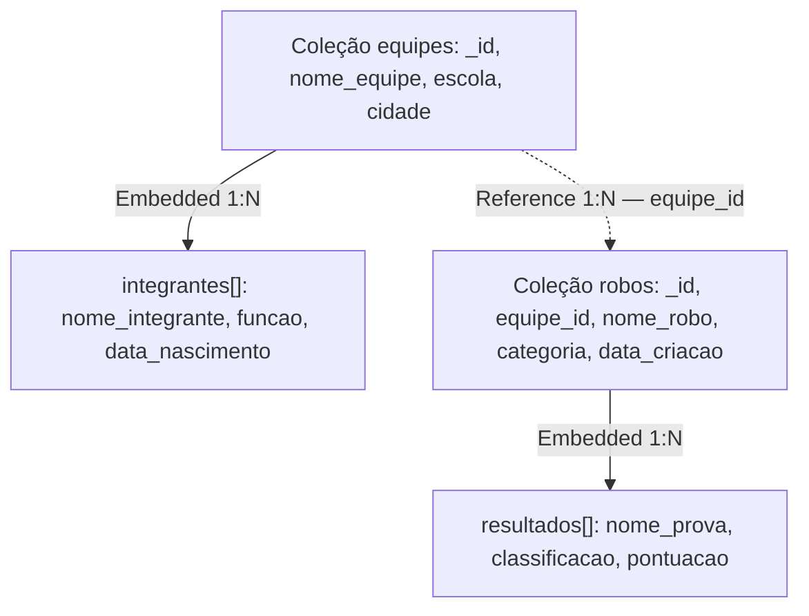

# 🤖 Sistema de Gerenciamento — Torneio de Robótica (IAAD)

Aplicação web desenvolvida em **Python (Dash + Plotly)**, integrada ao banco relacional **MySQL**, com um minicurso comparativo de **NoSQL (MongoDB + PyMongo)**. Projeto da disciplina **Introdução ao Armazenamento e Análise de Dados (IAAD)**.

---

## 👥 Integrantes da Equipe

- Danielle Victória Santana Jordão de Lira
- Ester de Souza Cavalcante
- Ismael Barros Soares
- Paulo Ricardo Ferreira de França
- Pedro Henrique de Oliveira Mota
- Riquelme Ruan Bezerra de Oliveira

---

## 📋 Funcionalidades

### Módulo Relacional — MySQL + Dash

- **Painel Geral (`painel_geral.py`):** reúne as quatro interfaces em abas, iniciando os dashboards por meio do botão Conectar.
- **Ranking e Resultados (`dashboard_ranking.py`):** indicadores de desempenho, consultas e CRUD completo de resultados.
- **Gestão de Robôs (`dashboard_robos.py`):** gráficos de distribuição por equipe e CRUD completo de robôs.
- **Gestão de Equipes (`dashboard_equipes.py`):** CRUD completo de equipes.
- **Gestão de Integrantes (`dashboard_integrantes.py`):** CRUD de integrantes e associação com equipes.
- **Integridade do Banco (`torneio_robotica_completo.sql`):** chaves estrangeiras, regras `ON DELETE CASCADE`, `ON DELETE RESTRICT` e `ON UPDATE CASCADE`.
- **Trigger (`trg_validar_pontuacao`):** impede a inserção de resultados com pontuação negativa.
- **Stored Procedure (`sp_desempenho_equipe`):** calcula indicadores de desempenho das equipes.

### Módulo Não Relacional — MongoDB + PyMongo

- Modelagem orientada a documentos.
- Documentos incorporados (*Embedded*) e referências (*Reference*).
- Operações CRUD: CREATE, READ, UPDATE e DELETE.
- Consultas entre coleções utilizando `$lookup`.
- Manipulação de arrays utilizando `$push` e `$pull`.
- Visualização das coleções pelo MongoDB Compass.

### Testes Automatizados

- Testes desenvolvidos com **Pytest**.
- Validação das operações CRUD.
- Verificação das chaves estrangeiras.
- Testes das restrições `RESTRICT` e `CASCADE`.
- Validação da chave primária composta.
- Testes da trigger e da stored procedure.
- **35 testes aprovados:** 23 de validação e 12 de integração MySQL, durante a execução realizada pela equipe.

---

## 🗂️ Estrutura do Repositório

```text
iaad/
├── assets/                         # Estilos CSS dos dashboards
├── nosql/
│   └── nosql_exemplos.py           # Exemplos de CRUD e relacionamentos MongoDB
├── tests/
│   ├── conftest.py                 # Configurações e fixtures dos testes
│   ├── test_validacoes.py          # Testes de validação
│   └── test_integracao_mysql.py    # Testes de integração MySQL
├── componentes.py                  # Componentes visuais reutilizáveis
├── conectar.py                     # Verificação de conexão MySQL
├── crud_equipes.py                 # CRUD da tabela equipe
├── crud_integrantes.py             # CRUD da tabela integrante
├── crud_robos_resultados.py        # CRUD das tabelas robo e resultado
├── dashboard_equipes.py            # Dashboard de equipes — Porta 8052
├── dashboard_integrantes.py        # Dashboard de integrantes — Porta 8053
├── dashboard_ranking.py           # Ranking e resultados — Porta 8050
├── dashboard_robos.py              # Dashboard de robôs — Porta 8051
├── gerenciamento_ui.py            # Interface compartilhada de gerenciamento
├── painel_geral.py                 # Painel unificado — Porta 8054
├── pytest.ini                      # Configurações do Pytest
├── ROTEIRO_TESTES_IAAD.md          # Documentação dos testes
├── torneio_robotica_completo.sql   # Banco, dados, trigger e procedure
├── torneiorobotica.mwb             # Modelo do MySQL Workbench
├── requirements.txt                # Dependências Python
└── README.md                       # Documentação do projeto
```

---

## 📐 Modelagem de Dados

### 1. Modelo Relacional — MySQL

O banco de dados `torneio_robotica` possui quatro tabelas:

| Tabela | Campos principais | Relacionamento |
|---|---|---|
| `equipe` | `id_equipe`, `nome_equipe`, `escola`, `cidade` | Entidade principal |
| `integrante` | `id_integrante`, `nome_integrante`, `funcao`, `data_nascimento`, `id_equipe` | Equipe 1:N integrantes |
| `robo` | `id_robo`, `nome_robo`, `categoria`, `data_criacao`, `id_equipe` | Equipe 1:N robôs |
| `resultado` | `nome_prova`, `classificacao`, `pontuacao`, `id_robo` | Robô 1:N resultados |

A tabela `resultado` utiliza chave primária composta por `nome_prova` e `classificacao`.

#### Regras de Integridade

- **Chaves estrangeiras:** garantem relacionamentos válidos entre os registros.
- **ON DELETE RESTRICT:** impede a exclusão de equipes que possuem robôs vinculados.
- **ON DELETE CASCADE:** remove automaticamente os resultados associados a um robô excluído.
- **ON UPDATE CASCADE:** propaga alterações nos identificadores relacionados.
- **Trigger:** impede a inserção de pontuação negativa.
- **Stored Procedure:** calcula indicadores de desempenho das equipes.

### 2. Modelo Não Relacional — MongoDB

No MongoDB, as informações são organizadas em duas coleções principais:

- **`equipes`:** armazena os dados das equipes e os integrantes incorporados.
- **`robos`:** armazena os robôs, seus resultados e a referência à equipe.

#### Modelagem Visual



#### Tipos de Relacionamento

**Embedded (Documentos Incorporados):**

Os integrantes ficam armazenados diretamente nos documentos das equipes, enquanto os resultados ficam incorporados nos documentos dos robôs.

**Reference (Referências):**

O campo `equipe_id` da coleção `robos` armazena uma referência ao `_id` da equipe correspondente.

O operador `$lookup` permite consultar informações relacionadas entre essas coleções, de maneira semelhante ao `JOIN` do MySQL.

Diferentemente das chaves estrangeiras do MySQL, referências comuns no MongoDB não implementam automaticamente regras como `CASCADE` e `RESTRICT`.

---

## 🚀 Instruções de Execução

### 1. Pré-requisitos

- Python 3.10 ou superior.
- MySQL Server 8.0 ou superior.
- MySQL Workbench.
- MongoDB Community Server para o módulo NoSQL.
- MongoDB Compass para visualizar documentos (opcional).
- Visual Studio Code ou outro editor Python.

### 2. Instalação das Dependências

Clone o repositório:

```powershell
git clone https://github.com/estersouza4/iaad.git
cd iaad
```

Crie o ambiente virtual:

```powershell
python -m venv .venv
```

Instale as dependências:

```powershell
.\.venv\Scripts\python.exe -m pip install -r requirements.txt
```

### 3. Configuração do MySQL

Abra o MySQL Workbench e execute o arquivo `torneio_robotica_completo.sql` para criar o banco e seus registros iniciais.

**ATENÇÃO:** o script contém `DROP DATABASE IF EXISTS torneio_robotica`. Executá-lo novamente apaga e recria o banco, eliminando alterações posteriores.

Para verificar se o MySQL está funcionando, execute no PowerShell:

```powershell
Get-Service MySQL80
```

Se estiver parado, abra o PowerShell como administrador e execute:

```powershell
Start-Service MySQL80
```

Configure as credenciais no terminal:

```powershell
$env:MYSQL_USER = "root"
$env:MYSQL_DATABASE = "torneio_robotica"
$env:MYSQL_PASSWORD = Read-Host "Senha do MySQL"
```

Caso seu usuário seja diferente de `root`, substitua pelo usuário correspondente.

Não publique senhas no GitHub.

### 4. Executando o Painel Geral

Com o banco MySQL funcionando, execute:

```powershell
.\.venv\Scripts\python.exe painel_geral.py
```

Acesse:

**http://127.0.0.1:8054**

Na interface:

1. Informe a senha do MySQL.
2. Clique em **Conectar**.
3. Aguarde a inicialização das aplicações.
4. Navegue entre as abas Ranking, Robôs, Equipes e Integrantes.

#### Portas dos Dashboards

| Dashboard | Porta |
|---|---|
| Ranking e Resultados | 8050 |
| Robôs | 8051 |
| Equipes | 8052 |
| Integrantes | 8053 |
| Painel Geral | 8054 |

**Observação:** a mensagem de inicialização não garante que todas as aplicações conseguiram acessar o banco. Verifique o carregamento das quatro abas.

Em versões recentes do Dash, o método `app.run_server()` não funciona. Caso necessário, utilize `app.run(debug=False, port=8053)` no arquivo `dashboard_integrantes.py`.

### 5. Executando os Dashboards Separadamente

Como alternativa ao Painel Geral, cada dashboard pode ser executado individualmente.

Abra um terminal para cada aplicação, configure as credenciais MySQL e execute o comando correspondente:

```powershell
# Ranking e Resultados
.\.venv\Scripts\python.exe dashboard_ranking.py
```

```powershell
# Robôs
.\.venv\Scripts\python.exe dashboard_robos.py
```

```powershell
# Equipes
.\.venv\Scripts\python.exe dashboard_equipes.py
```

```powershell
# Integrantes
.\.venv\Scripts\python.exe dashboard_integrantes.py
```

Não execute individualmente um dashboard cuja porta já esteja sendo utilizada pelo Painel Geral.

---

## 🍃 Minicurso NoSQL — MongoDB

### 1. Iniciando o MongoDB

Verifique o serviço:

```powershell
Get-Service MongoDB
```

Caso esteja parado, execute em um PowerShell como administrador:

```powershell
Start-Service MongoDB
```

### 2. Executando o Script NoSQL

Na pasta principal do projeto, execute:

```powershell
.\.venv\Scripts\python.exe nosql/nosql_exemplos.py
```

O script demonstra:

1. **CREATE:** cadastro de equipes, robôs e documentos incorporados.
2. **READ:** consultas e relacionamentos com `$lookup`.
3. **UPDATE:** atualização de informações e arrays com `$push`.
4. **DELETE:** exclusão de documentos e remoção de elementos com `$pull`.

**ATENÇÃO:** o script executa `db.equipes.drop()` e `db.robos.drop()` antes de inserir os dados de demonstração. Isso exclui as duas coleções existentes no banco `torneio_robotica_nosql`.

### 3. Visualizando no MongoDB Compass

Abra o MongoDB Compass e conecte utilizando:

```text
mongodb://127.0.0.1:27017/
```

Acesse o banco:

```text
torneio_robotica_nosql
```

As coleções principais são:

- `equipes`
- `robos`

Na coleção `equipes`, é possível visualizar os integrantes incorporados.

Na coleção `robos`, é possível consultar os resultados incorporados e as referências para equipes.

---

## 🧪 Testes Automatizados

O projeto utiliza **Pytest** para verificar as funcionalidades dos CRUDs e a integridade do banco MySQL.

Durante a validação realizada pela equipe, foram aprovados:

| Categoria | Testes aprovados |
|---|---:|
| Validações Python | 23 |
| Integração MySQL | 12 |
| **Total** | **35** |

### 1. Instalando o Pytest

```powershell
.\.venv\Scripts\python.exe -m pip install pytest
```

### 2. Executando os Testes de Validação

```powershell
.\.venv\Scripts\python.exe -m pytest -v tests/test_validacoes.py
```

### 3. Executando os Testes de Integração

Configure as credenciais MySQL e habilite os testes de integração:

```powershell
$env:IAAD_TESTAR_MYSQL = "SIM"
```

Depois execute:

```powershell
.\.venv\Scripts\python.exe -m pytest -v
```

Os testes verificam:

- Operações CRUD das tabelas do projeto.
- Integridade de chaves estrangeiras.
- Restrições `ON DELETE RESTRICT` e `ON DELETE CASCADE`.
- Propagação `ON UPDATE CASCADE`.
- Unicidade da chave primária composta.
- Funcionamento da trigger `trg_validar_pontuacao`.
- Execução da stored procedure `sp_desempenho_equipe`.

Os testes de integração utilizam transações reversíveis para evitar alterações permanentes, mas devem ser executados em um banco local de testes.

Sem `IAAD_TESTAR_MYSQL=SIM`, os testes de integração são ignorados (`SKIPPED`).

Mais informações estão disponíveis em `ROTEIRO_TESTES_IAAD.md`.

---

## ⚙️ Stored Procedure

A procedure `sp_desempenho_equipe` permite consultar indicadores de desempenho de uma equipe.

No MySQL Workbench, execute:

```sql
USE torneio_robotica;

CALL sp_desempenho_equipe(1);
```

Ela retorna informações como:

- Quantidade de robôs.
- Número de participações.
- Pontuação total.
- Pontuação média.
- Maior pontuação registrada.

A versão original do Painel Geral não possui uma interface específica para executar a procedure. Essa funcionalidade pode ser acrescentada separadamente.

---

## 🔎 Comparação MySQL × MongoDB

| Característica | MySQL | MongoDB |
|---|---|---|
| Modelo | Relacional | Orientado a documentos |
| Estrutura | Tabelas e linhas | Coleções e documentos |
| CREATE | `INSERT` | `insertOne()` / `insertMany()` |
| READ | `SELECT` | `find()` |
| UPDATE | `UPDATE` | `updateOne()` |
| DELETE | `DELETE` | `deleteOne()` |
| Relacionamentos | Chaves estrangeiras | Embedded e Reference |
| Consultas relacionadas | `JOIN` | `$lookup` |
| Integridade referencial | FK, CASCADE e RESTRICT | Sem FK automática nas referências |

---

## 📌 Considerações Finais

O projeto Torneio de Robótica demonstra a integração entre aplicações web em Python e bancos de dados relacionais e não relacionais.

No **MySQL**, foram implementadas operações CRUD, relacionamentos, regras de integridade, trigger e stored procedure.

No **MongoDB**, foram demonstradas operações CRUD, documentos incorporados, referências entre coleções e consultas utilizando agregações.

Além disso, o uso de testes automatizados com Pytest permitiu verificar funcionalidades e regras do banco relacional.

O projeto possibilitou comparar diferentes estratégias de armazenamento, relacionamento e gerenciamento de dados em um mesmo contexto acadêmico.

---

**Disciplina:** Introdução ao Armazenamento e Análise de Dados (IAAD)  
**Projeto:** Sistema de Gerenciamento — Torneio de Robótica

